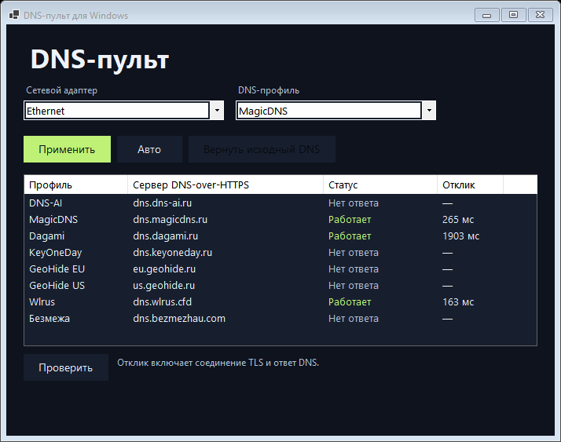

# DNS-пульт для Windows

DNS-пульт переключает системный DNS-over-HTTPS на выбранном Ethernet- или Wi‑Fi-адаптере. В окне видно, какие серверы отвечают и сколько занимает запрос.



## Запустить

Поддерживается Windows 11 x64 с русским или английским системным интерфейсом.

1. Скачайте `DNS-Panel-Windows-x64.zip` из [релизов](../../releases/latest).
2. Распакуйте архив и откройте `DNS-Panel-Windows.exe`.
3. Выберите сетевой адаптер. Чтобы выбрать профиль вручную, откройте список **DNS-профиль** и нажмите **Применить**. Чтобы выбрать самый быстрый из ответивших на проверку, нажмите **Авто**.
4. Подтвердите изменение в окне контроля учётных записей Windows.

Чтобы отключить профиль, нажмите **Вернуть исходный DNS** для того же адаптера. Пульт сохраняет настройки перед первым переключением, поэтому кнопка восстанавливает исходный режим DNS и адреса даже после смены нескольких профилей.

## Проверить серверы

Пульт проверяет серверы при открытии и каждую минуту, пока окно открыто. Кнопка **Проверить** запускает новый замер. Отклик включает открытие HTTPS-соединения и ответ на DNS-запрос. Профиль применяется к тем семействам адресов, IPv4 или IPv6, в которых сервер ответил. Доступность ChatGPT, Gemini и других сервисов зависит от сети и правил самих сервисов.

Профили используют серверы сторонних операторов. Выбранный оператор получает DNS-запросы этого адаптера. Для самого переключения используется встроенный в Windows DNS-over-HTTPS. [Документация Microsoft](https://learn.microsoft.com/en-us/windows/win32/api/netioapi/ns-netioapi-dns_interface_settings3)

## Собрать из исходников

Понадобится .NET 10 SDK для Windows.

```powershell
dotnet publish DnsPanel.csproj -c Release -r win-x64 --self-contained true -p:PublishSingleFile=true -p:IncludeNativeLibrariesForSelfExtract=true -p:EnableCompressionInSingleFile=true
```

См. также [DNS-пульт для Android](https://github.com/dryberi1-dev/dns-panel-android).
